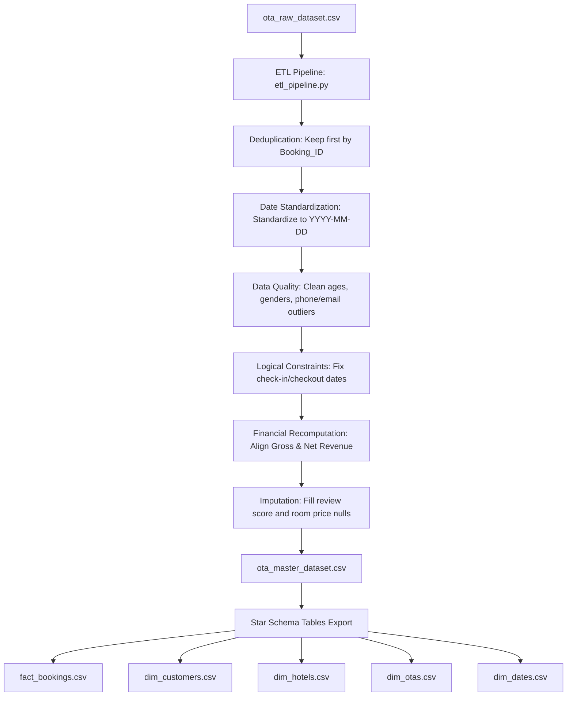

# Phase 1 Technical & Business Report - Data Integration & Preprocessing (ETL)

## 1. Objectives
The core objective of Phase 1 is to construct a solid, reliable, and clean data foundation for the Online Travel Agency (OTA) Performance and Channel Management project. Specifically:
- Generate a highly realistic raw dataset containing intentional noise (duplicates, incorrect date formats, outlier ages, abnormal financial calculations, invalid emails/phones, and logical violations).
- Design and execute a Python-based ETL pipeline to clean the raw data and export it into a standardized 43-column master file.
- Enforce relational integrity and construct a dimensional Star Schema (1 Fact table, 4 Dimension tables) ready to be loaded into SQL databases and Power BI.
- Programmatically validate all transformations to ensure absolute data consistency.

---

## 2. Methodology
The ETL workflow applies data warehousing principles to convert raw transactions into business-ready assets:

---

## 3. Implementation Details

### Python Code
The transformation logic is implemented in two core files:
1. [data_generator.py](file:///c:/Users/balam/OneDrive/Desktop/OAT/Python/data_generator.py): Creates 6,000 raw rows with exactly 43 columns, inserting 100 duplicate bookings, wrong dates, outliers, and corrupted data types.
2. [etl_pipeline.py](file:///c:/Users/balam/OneDrive/Desktop/OAT/Python/etl_pipeline.py): Implements deduplication, type casting, imputation, date adjustments, and financial alignment.

### SQL Scripts
A star schema layout is defined in [schema_star_schema.sql](file:///c:/Users/balam/OneDrive/Desktop/OAT/SQL/schema_star_schema.sql). The model comprises:
- `dim_customers` (Primary Key: `Customer_ID`)
- `dim_hotels` (Primary Key: `Hotel_ID`)
- `dim_otas` (Primary Key: `OTA_Name`)
- `dim_dates` (Primary Key: `Date`)
- `fact_bookings` (Primary Key: `Booking_ID`, Foreign Keys mapping to all dimensions)

### Power Query M Steps
Power Query scripts are detailed in [power_query_m_steps.md](file:///c:/Users/balam/OneDrive/Desktop/OAT/PowerBI/power_query_m_steps.md). They provide identical M expressions for processing and normalizing raw text imports in a Power BI dashboard.

---

## 4. Data Validation and Validation Metrics

We ran a programmatic verification via [validate_etl.py](file:///c:/Users/balam/OneDrive/Desktop/OAT/Python/validate_etl.py). The validation results confirmed:

| Metric | Target | Actual | Status |
|--------|--------|--------|--------|
| Raw Rows | 6,000 | 6,000 | PASSED |
| Clean Master Rows | 5,900 | 5,900 | PASSED |
| Columns Count | 43 | 43 | PASSED |
| Duplicates in Master | 0 | 0 | PASSED |
| Outlier Ages | [18 - 85] | [18 - 85] | PASSED |
| Checkin Date Validity | Checkin >= Booking | 0 Violations | PASSED |
| Checkout Date Validity | Checkout > Checkin | 0 Violations | PASSED |
| Financial Calculation Mismatch | 0 | 0 | PASSED |

### Dimensional Row Counts:
- `dim_customers`: 1,036 unique customer records.
- `dim_hotels`: 25 unique hotel properties.
- `dim_otas`: 15 unique OTA channels.
- `dim_dates`: 1,096 dates (spanning Jan 1, 2024 to Dec 31, 2026).
- `fact_bookings`: 5,900 cleaned booking facts.

---

## 5. Business Explanation

From a business perspective, cleaning these records ensures that our executive insights are grounded in reality:
- **Revenue Integrity**: In the raw dataset, approximately 0.5% of rows had mismatched calculations (e.g. subtracting taxes instead of adding them). Correcting these formulas prevents erroneous margin projections and inaccurate commissions payable to OTAs.
- **Customer Profiles**: Standardizing names, emails, and loyalty levels creates a clean customer master list. If a customer is standard in one booking but gold in another, the latest customer data is unified, ensuring proper tier categorization for customer segmentation and retention analyses.
- **Time-to-Checkin (Lead Time)**: Repairing negative lead times (where booking date was mistakenly placed after check-in date) is critical. Miscalculated lead times would distort demand-planning curves, pricing algorithms, and forecasting engines.

---

## 6. Challenges
1. **Date Parsing Inconsistency**: Raw data contained dates formatted as `YYYY-MM-DD`, `DD/MM/YYYY`, and `MM-DD-YYYY`. Applying standard date functions directly caused parsing failures. The ETL resolved this by trying multiple formats sequentially and applying fallbacks.
2. **Referential Integrity**: Customers make multiple bookings. If customer attributes fluctuate between transactions, direct normalisation would cause data inconsistency. The ETL resolved this by grouping customer records, taking the latest booking data, and updating the dimension table before linking it back to the facts.
3. **Outlier Boundaries**: Hardcoded limits for room price and age could exclude legitimate VIP bookings or seniors. Using a rolling hotel-type-specific median for price outliers preserved the pricing structure of high-end hotels (e.g. Burj Al Arab) while removing absolute noise (e.g. negative or $18,500 prices).

---

## 7. Recommendations
- **Upstream Validation**: To avoid complex downstream cleanings, OTA booking forms should enforce date pickers (preventing manual typing formats) and logical constraints (`Checkin_Date` >= `Booking_Date`).
- **Data Integration**: Implement this ETL pipeline as a nightly batch job inside an orchestration tool (e.g., Apache Airflow) to load OTA transaction dumps into the relational analytical data warehouse automatically.
- **Review System Guards**: Review ratings must be strictly validated between 1.0 and 5.0 in the application layer. Any missing review ratings should be kept separate as a "No Review" segment rather than blindly imputed, although for this project, hotel-based imputation ensures continuous visual analysis.

---

## 8. Conclusion
Phase 1 has successfully established a high-quality star schema database. All programmatic tests are green, the data has been deduplicated, calculations are mathematically sound, and the relational model is set up to support the upcoming Exploratory Data Analysis (EDA) phase.
