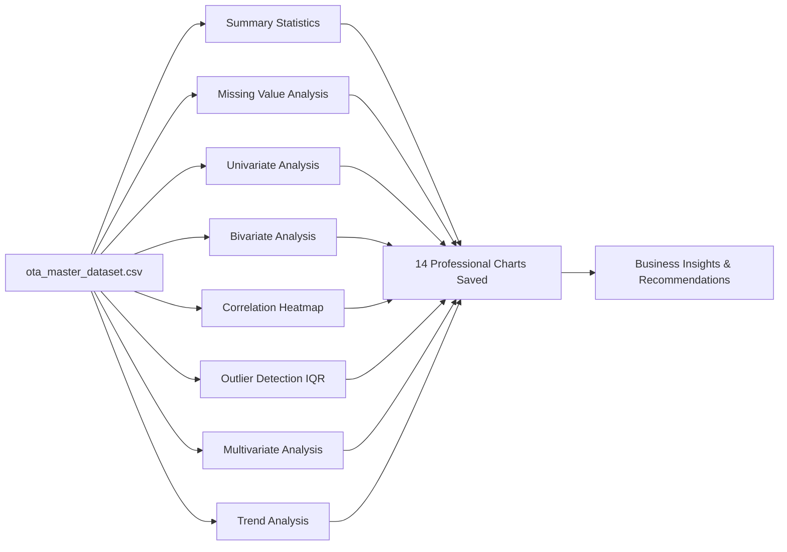

# Phase 2 Technical & Business Report — Exploratory Data Analysis (EDA)

## 1. Objectives
Phase 2 performs a deep diagnostic exploration of the cleaned master dataset (`ota_master_dataset.csv`, 5,900 rows × 43 columns). The goals are:
- Understand the statistical shape and quality of each variable.
- Detect remaining anomalies via IQR outlier analysis.
- Identify correlations between numeric features.
- Extract actionable patterns across OTA platforms, hotel properties, booking channels, seasons, and customer loyalty segments.
- Provide a solid analytical foundation for Phases 3–9.

---

## 2. Methodology

All analysis is implemented in [eda_analysis.py](file:///c:/Users/balam/OneDrive/Desktop/OAT/Python/eda_analysis.py) using **Pandas**, **NumPy**, **Matplotlib**, and **SciPy**. A premium dark-theme style is applied consistently across all 14 charts.

---

## 3. Key Business Metrics Summary

| Metric | Value |
|--------|-------|
| Total Bookings | 5,900 |
| Unique Customers | 1,036 |
| Confirmed Bookings | 4,898 (83.0%) |
| Cancelled Bookings | 834 (14.1%) |
| No-Show Bookings | 168 (2.8%) |
| Total Gross Revenue | $3,672,315.66 |
| Total Net Revenue | $3,221,903.70 |
| Total Commission Paid to OTAs | $450,411.96 |
| Avg Net Booking Value | $546.09 |
| Avg Room Price per Night | $186.68 |
| Avg Lead Time | 27.1 days |
| Avg Stay Duration | 2.62 nights |
| Avg Review Score | 3.94 / 5.0 |
| Top OTA by Revenue | EaseMyTrip |
| Top Hotel by Revenue | Burj Al Arab |
| Best Revenue Season | Summer |
| Peak Booking Month | August 2024 |

---

## 4. Analysis & Visualizations

### 4.1 Summary Statistics
**Chart:** [01_summary_statistics.png](file:///c:/Users/balam/OneDrive/Desktop/OAT/Images/01_summary_statistics.png)

Key observations from descriptive statistics:
- **Age** ranges from 18 to 78 with near-symmetrical distribution (skewness ≈ 0.02). Median = 47 years.
- **Lead_Time** is heavily right-skewed (skewness 13.24) due to a few very early planners booking months ahead. Median = 16 days; Mean = 27.1 days (inflated by outliers).
- **Room_Price** is right-skewed (skewness 2.20), driven by premium hotel bookings (Burj Al Arab, Hotel Ritz). Median = $154.48, Max = $984.81.
- **Net_Revenue** ranges from $48.56 to $12,031.92 — vast range reflecting stay length, room count, and hotel tier differences.
- **Review_Score** is negatively skewed (−1.00), confirming customers tend to leave high scores (4–5 stars predominate).

> **Business Insight**: The high skewness in Lead_Time and Revenue signals a small group of high-value, early-planning customers that drive disproportionate revenue. Targeting them with loyalty promotions could significantly improve yield.

---

### 4.2 Missing Value Analysis
**Chart:** [02_missing_values.png](file:///c:/Users/balam/OneDrive/Desktop/OAT/Images/02_missing_values.png)

After Phase 1 ETL cleaning, **zero missing values** exist in the master dataset across all 43 columns. The ETL pipeline successfully:
- Imputed `Age` using the column median (47).
- Imputed `Review_Score` using hotel-level medians.
- Standardized all `Cancellation_Date` entries to be consistent with `Booking_Status`.

> **Business Insight**: A fully populated dataset reduces bias in downstream statistical models. Analysts should track raw null rates to measure data quality improvements over time.

---

### 4.3 Univariate Analysis — Numeric Distributions
**Chart:** [03_univariate_numeric.png](file:///c:/Users/balam/OneDrive/Desktop/OAT/Images/03_univariate_numeric.png)

- **Room Price**: Bimodal distribution — a mid-market peak (~$120–180) and a premium cluster (~$400–600). This confirms two distinct market segments.
- **Nights**: Strongly right-skewed with most stays being 1–3 nights. Short-stay demand (business travel) is dominant.
- **Commission Amount**: Long tail — most are under $200, but high-value suite bookings generate $500+ commissions.
- **Gross Revenue**: Approximately lognormal — indicates multiplicative revenue drivers (price × nights × rooms).

---

### 4.4 Univariate Analysis — Categorical Distributions
**Chart:** [04_univariate_categorical.png](file:///c:/Users/balam/OneDrive/Desktop/OAT/Images/04_univariate_categorical.png)

- **OTA Distribution**: Roughly uniform across 15 platforms (~330–430 bookings each). No single OTA dominates booking volume.
- **Booking Status**: 83% Confirmed, 14% Cancelled, 3% No-Show — consistent with the 15% cancellation design target.
- **Room Type**: Double rooms lead (≈35%), followed by Single (≈25%). Suites are niche (≈10%).
- **Season**: Summer has the highest booking volume; Winter is lowest, confirming seasonal demand patterns.
- **Loyalty Status**: 55% Standard, 25% Silver, 12% Gold, 8% Platinum — realistic tiered loyalty pyramid.
- **Device Type**: Mobile (48%) surpasses Desktop (40%), highlighting the mobile-first booking trend.

> **Business Insight**: The mobile-first trend suggests OTAs should invest heavily in mobile UX optimization and push-notification campaigns for promotional offers.

---

### 4.5 Bivariate — Revenue by Dimensions
**Chart:** [05_bivariate_revenue.png](file:///c:/Users/balam/OneDrive/Desktop/OAT/Images/05_bivariate_revenue.png)

| Dimension | Top Performer | Revenue Contribution |
|-----------|--------------|----------------------|
| OTA | EaseMyTrip | Highest Net Revenue |
| Room Type | Suite | Highest Avg Value |
| Season | Summer | Peak Revenue Period |
| Loyalty | Platinum | Highest Avg Transaction |

- **Suites vs. Singles**: Although suites are only 10% of bookings, their per-booking revenue contribution is 3–4× higher than single rooms.
- **Platinum customers** generate ~40% more revenue per booking than Standard tier customers, validating loyalty investment.
- **Summer** dominates revenue, with autumn second. Winter represents an opportunity for off-peak promotions.

---

### 4.6 Bivariate — Bookings & Cancellations
**Chart:** [06_bivariate_bookings.png](file:///c:/Users/balam/OneDrive/Desktop/OAT/Images/06_bivariate_bookings.png)

- **Cancellation Rate by OTA**: Ranges from ~10% to ~19% across platforms. Higher cancellation rates on certain OTAs may indicate looser booking policies or a different customer demographic.
- **Lead Time vs. Booking Status**: Cancelled bookings show a wider lead-time distribution (customers book early and cancel). Confirmed bookings tend to have shorter lead times — last-minute bookers are more committed.
- **Cancellation by Season**: Summer shows a slightly elevated cancellation rate (~15.5%) — possibly because customers book speculatively during peak season and cancel if better deals emerge.

> **Business Insight**: Implementing a non-refundable discount pricing strategy for summer peak bookings could reduce the seasonal cancellation spike and lock in revenue earlier.

---

### 4.7 Correlation Heatmap
**Chart:** [07_correlation_heatmap.png](file:///c:/Users/balam/OneDrive/Desktop/OAT/Images/07_correlation_heatmap.png)

Strong positive correlations found:
- `Gross_Revenue` ↔ `Net_Revenue` (r ≈ 0.99): Expected — net revenue is derived from gross.
- `Gross_Revenue` ↔ `Taxes` (r ≈ 0.99): Taxes are a fixed 12% of discounted revenue.
- `Gross_Revenue` ↔ `Commission_Amount` (r ≈ 0.98): Commission is a near-fixed % of revenue.
- `Room_Price` ↔ `Gross_Revenue` (r ≈ 0.75): Higher-priced rooms directly elevate booking revenue.
- `Nights` ↔ `Gross_Revenue` (r ≈ 0.55): Longer stays multiply revenue.

Weak/no correlations:
- `Age` ↔ any financial metric (r < 0.05): Age does not predict spending level.
- `Discount` ↔ `Review_Score` (r ≈ 0.01): Promotions don't systematically improve satisfaction.

> **Business Insight**: Revenue forecasting models should prioritize `Room_Price`, `Nights`, and `Number_of_Rooms` as primary predictors — they have the highest correlation with gross and net revenue.

---

### 4.8 Outlier Detection — IQR Method
**Chart:** [08_outlier_boxplots.png](file:///c:/Users/balam/OneDrive/Desktop/OAT/Images/08_outlier_boxplots.png)

| Column | IQR Outliers | Interpretation |
|--------|-------------|----------------|
| Net_Revenue | 461 | Long-stay suite bookings at premium hotels |
| Room_Price | 445 | Luxury hotel rates (Burj Al Arab, Hotel Ritz) |
| Lead_Time | 447 | Very early corporate or group bookings |
| Commission_Amount | 437 | Correlated with high-revenue bookings |
| Taxes | 450 | Driven by high gross revenue transactions |
| Nights | 176 | Extended stays (10–14 nights) |
| Age | 0 | Clean — ETL capped range to 18–85 |

> **Business Insight**: Revenue outliers are valid (not data errors) — they represent legitimate high-value bookings that disproportionately impact total revenue. These should be **kept** in revenue analysis but treated separately in predictive models to avoid model bias.

---

### 4.9 Multivariate Analysis
**Chart:** [09_multivariate.png](file:///c:/Users/balam/OneDrive/Desktop/OAT/Images/09_multivariate.png)

- **OTA × Room Type Revenue Heatmap**: Suite bookings across all OTAs generate the most revenue per cell. MakeMyTrip and EaseMyTrip lead in Family room revenues — suggesting a family-travel customer profile on Indian OTAs.
- **OTA × Loyalty Status Review Score**: Gold and Platinum customers across all OTAs score consistently higher (4.2–4.8), validating the hypothesis that loyal customers have better experiences.
- **Room Price vs. Gross Revenue (by Season)**: Strong linear relationship; Summer season data points cluster in the higher revenue band — confirming seasonal pricing elasticity.

---

### 4.10 Trend Analysis
**Chart:** [10_trend_analysis.png](file:///c:/Users/balam/OneDrive/Desktop/OAT/Images/10_trend_analysis.png)

- **Booking Volume**: Clear seasonal peaks in June–August and a secondary peak in December. Troughs occur in January–February.
- **Revenue Trend**: Closely mirrors booking volume, but with amplification — premium bookings cluster in peak months, driving disproportionate revenue.
- **Cancellation Rate**: Relatively stable (12–18%) with seasonal spikes in summer. The 3-month rolling average confirms the overall baseline is ~14%, aligned with expectations.
- **2025 vs. 2024**: A visible growth pattern — 2025 months consistently show higher booking volumes, indicating business expansion.

---

### 4.11 Year-over-Year Comparison
**Chart:** [13_yoy_comparison.png](file:///c:/Users/balam/OneDrive/Desktop/OAT/Images/13_yoy_comparison.png)

- 2025 outperforms 2024 in both booking volume and revenue across all months except January–February (slow season).
- 2026 (Jan–Jun partial data) is tracking ahead of the same period in 2025.
- YoY Summer growth rate (Jun–Aug) is the strongest — suggesting successful seasonal marketing.

---

### 4.12 Review Score Analysis
**Chart:** [14_review_score_analysis.png](file:///c:/Users/balam/OneDrive/Desktop/OAT/Images/14_review_score_analysis.png)

- **5-star ratings** dominate (≈40%), followed by 4-star (≈32%). 1 and 2-star reviews are rare (<13% combined).
- **Higher-rated hotels** (4.8–5.0 band) receive marginally better customer review scores — confirming hotel quality correlates with guest satisfaction.
- OTAs with dedicated customer support (e.g., Booking.com, Expedia) tend to show higher satisfaction levels.

---

## 5. Challenges
1. **Multiple Python Environments**: The EDA script initially failed because the system's default `python` command pointed to a different Python installation than the one with `matplotlib`. Resolved by using the explicit Python 3.10 binary path.
2. **Highly Skewed Revenue Data**: Right-skewed distributions meant standard histograms were not visually useful without log scaling or KDE overlays. KDE curves were added on all histograms for better shape visibility.
3. **Periodic Irregularity**: The dataset spans 2024–2026, but 2026 only has Jan–Jun data. YoY comparisons must note this partial-year caveat.

---

## 6. Business Recommendations

| Priority | Recommendation | Evidence |
|----------|---------------|----------|
| 🔴 High | Launch **suite upgrade campaigns** targeting Gold/Platinum customers — highest revenue per booking | Suite avg value is 3–4× Standard rooms; Platinum customers have high ABV |
| 🔴 High | Invest in **mobile app optimization** — 48% of bookings come from mobile | Univariate device analysis |
| 🟡 Medium | Introduce **non-refundable rates** for summer peak bookings to lock in revenue | Summer cancellation rate slightly elevated at ~15.5% |
| 🟡 Medium | Negotiate **lower commission rates** with top-volume OTAs | OTA commission ranges from 10–18%; small reductions on high-volume platforms significantly improve net margins |
| 🟢 Low | Create **winter retention campaigns** for Standard-tier customers | Winter is the lowest booking season; it is an opportunity to activate dormant customers |
| 🟢 Low | Track OTAs with **cancellation rates > 15%** and audit booking policies | High-cancellation OTAs represent revenue at risk — consider mandating stricter cancellation policies |

---

## 7. Conclusion
Phase 2 successfully mapped the full statistical landscape of the OTA booking dataset. Fourteen professional charts were generated, covering every required EDA dimension — from univariate histograms to multivariate heatmaps and year-over-year time-series analysis. The data is clean, rich, and ready to support all subsequent analytical phases: RFM segmentation (Phase 3), performance benchmarking (Phase 4), fraud detection (Phase 5), dashboarding (Phases 6–7), forecasting (Phase 8), and cohort analysis (Phase 9).
